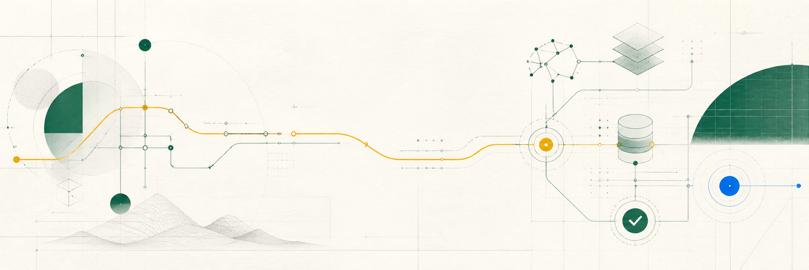

  

  
  
  
  

# Самандар Мансурходжаев

**Продуктовый full-stack разработчик · AI-автоматизация · QA / Quality Engineering · Founder**

Я превращаю идею в работающую систему: уточняю проблему, проектирую пользовательский путь и архитектуру, собираю интерфейс и backend, подключаю AI и интеграции, затем проверяю критические риски и довожу продукт до понятного, проверяемого релиза.

Основной стек: **TypeScript / React / Next.js, Python / FastAPI, PostgreSQL / Supabase, AI / RAG, автоматизация и тестирование**. Мне одинаково важны ценность для пользователя, ясность архитектуры и качество, которое можно подтвердить кодом, тестами, документацией или рабочим демо.

## Начать отсюда

### 01 / [Klawis](https://klawis.uz) — Legal AI, который отвечает с опорой на источник

Живой продукт для навигации по правовым вопросам Узбекистана: маршрутизация запроса, retrieval, цитаты, детерминированная логика подсудности и UX для чувствительного домена. Не выдаёт модельный ответ за юридическое заключение.

`FastAPI` `Next.js` `Supabase / pgvector` `RAG` `SSE` `AI evaluation`

### 02 / [Доступное Право](https://dostupnoe-pravo-alpha.vercel.app) — Legal CRM с реальным качеством в фундаменте

Публичная CRM для юридической практики: клиенты, дела, статусы, история и следующий шаг. В основе — изоляция данных, конкурентные обновления, интеграции и **192 автоматизированные проверки**.

[Открыть демо](https://dostupnoe-pravo-alpha.vercel.app) · [Исходный код](https://github.com/SamandarMansurkhodjaev2713/dostupnoe-pravo)

`Next.js` `TypeScript` `PostgreSQL / RLS` `Playwright` `CI`

### 03 / [TTYL Platform](https://github.com/SamandarMansurkhodjaev2713/private-projects-showcase/blob/main/cards/ttyl-platform.md) — приватная on-prem платформа для команд

Система уровня внутреннего workspace: проекты, задачи, чаты, файлы, поиск, аудит, роли, realtime и хранение внутри инфраструктуры заказчика. Публично показана безопасная архитектурная карточка, без кода и данных клиента.

`NestJS` `Next.js` `PostgreSQL` `Redis` `MinIO` `WebSocket` `RBAC`

### 04 / [Softly / CoupleOS](https://softlylove.uz) — founder-led продукт для пар

Mobile-first сервис с приватными сценариями, ритуалами, PWA и продуманным emotional UX. Здесь я веду продуктовую логику, UX, full-stack реализацию и релизный контур как основатель.

`Next.js` `Supabase Auth / RLS` `PWA` `product design` `privacy-first`

### 05 / [GrowthOps AI](https://github.com/SamandarMansurkhodjaev2713/growthops-ai) — каталог прикладной автоматизации для SMB

Портфель узких бизнес-автоматизаций, где детерминированные правила отвечают за деньги и необратимые действия, а AI используется только там, где действительно добавляет ценность. Публичная витрина отделяет доказанное от плана развития.

`AI workflows` `PostgreSQL` `concurrency checks` `human-in-the-loop` `product systems`

### 06 / [ChAT-app](https://github.com/SamandarMansurkhodjaev2713/ChAT-app) — mobile architecture и QA за пределами happy path

Offline-first мессенджер с долговечной очередью отправки, realtime, OTP и проверяемыми security rules. Проект показывает, как я думаю о потере сети, повторной отправке, доступах и восстановлении, а не только об экранах.

`React Native / Expo` `Firebase` `SQLite` `strict TypeScript` `234 automated checks`

### 07 / [QA-портфолио](https://github.com/SamandarMansurkhodjaev2713/qa-engineering-portfolio) — качество как инженерная дисциплина

Собраны проверяемые кейсы по рискам, тест-дизайну, API, SQL, UI/E2E и автоматизации. Для каждого проекта разделены реализованное покрытие, остаточный риск и следующий ценный слой проверок.

[Матрица качества](https://github.com/SamandarMansurkhodjaev2713/qa-engineering-portfolio/blob/main/docs/project-quality-matrix.md) · [Публичные workflows](https://github.com/SamandarMansurkhodjaev2713/qa-engineering-portfolio/actions)

## Полная карта работ

<b>Продукты, AI и бизнес-системы</b>

- [CarSuperApp](https://github.com/SamandarMansurkhodjaev2713/private-projects-showcase/blob/main/cards/carsuperapp.md) — multi-tenant PWA для автосервисов, RLS, recovery и risk-based QA.
- [AI Classroom](https://github.com/SamandarMansurkhodjaev2713/private-projects-showcase/blob/main/cards/ai-classroom.md) — privacy-first AI-аналитика аудитории с human review.
- [Forge / Learning OS](https://github.com/SamandarMansurkhodjaev2713/private-projects-showcase/blob/main/cards/forge-learning-os.md) — project-first learning platform и evidence engine.
- [Дело](https://github.com/SamandarMansurkhodjaev2713/private-projects-showcase/blob/main/cards/delo.md) — публичная demo-CRM с изолированным workspace и канбаном.
- [Platform Core](https://github.com/SamandarMansurkhodjaev2713/private-projects-showcase/blob/main/cards/platform-core.md) — gateway, омниканальный hub и AI evaluation foundation.
- [BOMOND Engineering Pack](https://github.com/SamandarMansurkhodjaev2713/private-projects-showcase/blob/main/cards/bomond-engineering-pack.md) — управляемый контур требований, архитектуры, аудита и качества для AI-разработки.

<b>Автоматизация, агенты и backend</b>

- [BelfProctor](https://github.com/SamandarMansurkhodjaev2713/private-projects-showcase/blob/main/cards/belfproctor.md) — Windows agent, backend ingestion, telemetry и admin review.
- [Marketbot](https://github.com/SamandarMansurkhodjaev2713/private-projects-showcase/blob/main/cards/marketbot.md) — event-driven commerce automation.
- [Task Manage Bot](https://github.com/SamandarMansurkhodjaev2713/private-projects-showcase/blob/main/cards/task-manage-bot.md) — voice-to-task, роли, дедлайны, очереди и напоминания.
- [Vacation Agent](https://github.com/SamandarMansurkhodjaev2713/private-projects-showcase/blob/main/cards/vacation-agent.md) — корпоративный workflow отпусков, документы, импорт Excel и подтверждения.
- [Birthday Agent](https://github.com/SamandarMansurkhodjaev2713/private-projects-showcase/blob/main/cards/birthday-agent.md) — безопасная автоматизация корпоративных поздравлений, 718 тестов.
- [B24 Agent](https://github.com/SamandarMansurkhodjaev2713/private-projects-showcase/blob/main/cards/b24agent.md) — аналитический агент продаж для Bitrix24.
- [AI Support](https://github.com/SamandarMansurkhodjaev2713/private-projects-showcase/blob/main/cards/p03-support.md), [AI Booking](https://github.com/SamandarMansurkhodjaev2713/private-projects-showcase/blob/main/cards/p04-booking.md) и [LeadHunter](https://github.com/SamandarMansurkhodjaev2713/private-projects-showcase/blob/main/cards/p06-leadhunter.md) — три продукта с чёткими guardrails, без спама и небезопасных действий.
- [LaplaceFX](https://github.com/SamandarMansurkhodjaev2713/private-projects-showcase/blob/main/cards/laplacefx.md) — исследовательский Forex-бот с demo execution, risk management и наблюдаемостью.

<b>Mobile, desktop, data, embedded и frontend</b>

- [CardioGuard](https://samandarmansurkhodjaev2713.github.io/cardioguard/) и [med-exe](https://github.com/SamandarMansurkhodjaev2713/private-projects-showcase/blob/main/cards/med-exe.md) — кроссплатформенный и desktop health-tech.
- [Sentinel Edge](https://samandarmansurkhodjaev2713.github.io/sentinel-edge-smart-system/) и [BioFlux Observer](https://github.com/SamandarMansurkhodjaev2713/bioflux-observer) — embedded/industrial telemetry от firmware до dashboard.
- [IZATULO / BEL ALMA](https://izzatullo.uz/) — мультиязычный B2B-сайт с SEO и Playwright E2E.
- [Helion](https://samandarmansurkhodjaev2713.github.io/helion/), [Stones](https://github.com/SamandarMansurkhodjaev2713/stones), [3D Landing](https://samandarmansurkhodjaev2713.github.io/3d-landing/) — публичные frontend-проекты с interaction design, i18n и производительностью.
- [Lazy Coding](https://github.com/SamandarMansurkhodjaev2713/private-projects-showcase/blob/main/cards/lazy-coding.md) — computer vision gesture mouse.

Полный реестр, включая рабочие заготовки, версии и пустые репозитории, находится в [Project Register](https://github.com/SamandarMansurkhodjaev2713/private-projects-showcase/blob/main/PROJECT_REGISTER.md). Он нужен для полноты, но не смешивает будущую работу с готовыми продуктами.

## Как я обеспечиваю качество

- начинаю с требований, рисков и критериев приёмки, а не с хаотичной проверки готового интерфейса;
- выбираю слой проверки по цене дефекта: domain/unit, API и интеграции, данные/SQL, UI и критичные E2E-пути;
- автоматизирую стабильные повторяемые проверки, а исследовательское тестирование оставляю человеку;
- использую Playwright, pytest, Vitest/Jest, xUnit, Postman/Newman, SQL, DevTools, Docker и GitHub Actions по назначению;
- фиксирую не только «готово», но и ограничения, точки отказа, диагностику, критерии релиза и остаточный риск.

## Стек и контакт

**Frontend:** TypeScript, React, Next.js, React Native, Vite, Tailwind CSS, Three.js

**Backend:** Python, FastAPI, Node.js, NestJS, Rust, Go, REST, WebSocket, background jobs

**AI:** RAG, structured outputs, model routing, evaluations, OpenAI/Gemini integrations, AI workers

**Data & infrastructure:** PostgreSQL, Supabase, Redis, RabbitMQ, MinIO, Docker, GitHub Actions
**Quality:** test design, Playwright, pytest, Vitest/Jest, xUnit, Postman/Newman, SQL, CI quality gates

Получаю высшее IT-образование: **3 курс бакалавриата Software Engineering в IT Park University**. Открыт к full-time ролям, контрактной разработке и продуктовым коллаборациям.

**Email:** [sam4k27@gmail.com](mailto:sam4k27@gmail.com) · **Telegram:** [@KillAllOfThem13](https://t.me/KillAllOfThem13) · **Ташкент, Узбекистан**

---

# English

  
  

## Samandar Mansurkhodjaev

**Product-minded full-stack developer · AI automation · QA / Quality Engineering · Founder**

I take an idea from problem framing through user journey, architecture, frontend/backend, AI and integrations to a release with explicit quality evidence. My core stack is **TypeScript / React / Next.js, Python / FastAPI, PostgreSQL / Supabase, applied AI / RAG and automation**.

## Start here

**[Klawis](https://klawis.uz)** — live legal AI navigator grounded in sources, deterministic jurisdiction logic and evaluation-aware UX.

**[Dostupnoe Pravo](https://dostupnoe-pravo-alpha.vercel.app)** — live legal CRM with PostgreSQL/RLS, concurrency control, CI and 192 automated checks.

**[TTYL Platform](https://github.com/SamandarMansurkhodjaev2713/private-projects-showcase/blob/main/cards/ttyl-platform.md)** — private on-prem collaboration system with RBAC, realtime, files, audit and enterprise boundaries.

**[Softly / CoupleOS](https://softlylove.uz)** — founder-led mobile-first relationship product with private flows, PWA and privacy-first design.

**[GrowthOps AI](https://github.com/SamandarMansurkhodjaev2713/growthops-ai)** — catalog of deterministic, human-reviewed business automations.

**[ChAT-app](https://github.com/SamandarMansurkhodjaev2713/ChAT-app)** — offline-first React Native messenger with a durable outbox, OTP and 234 automated checks.
**[QA portfolio](https://github.com/SamandarMansurkhodjaev2713/qa-engineering-portfolio)** — risk-based quality evidence across product, API, data, UI and E2E work.

## Full work map

The [Project Atlas](https://github.com/SamandarMansurkhodjaev2713/private-projects-showcase) groups public work and code-safe private case studies across product systems, AI automation, QA, mobile, desktop, embedded, data and frontend. The [Project Register](https://github.com/SamandarMansurkhodjaev2713/private-projects-showcase/blob/main/PROJECT_REGISTER.md) keeps the inventory complete without presenting drafts as shipped products.

## Quality engineering

I start with requirements, risks and acceptance criteria; choose the test layer by the cost of failure; automate stable high-value checks; and document residual risk alongside coverage. My tools include Playwright, pytest, Vitest/Jest, xUnit, Postman/Newman, SQL, DevTools, Docker and GitHub Actions.

**Frontend:** TypeScript, React, Next.js, React Native, Vite, Tailwind CSS, Three.js

**Backend:** Python, FastAPI, Node.js, NestJS, Rust, Go, REST, WebSocket
**Data & infrastructure:** PostgreSQL, Supabase, Redis, RabbitMQ, MinIO, Docker, GitHub Actions

Third-year **Software Engineering** bachelor’s student at IT Park University. Open to full-time roles, contract work and product collaborations.

**Email:** [sam4k27@gmail.com](mailto:sam4k27@gmail.com) · **Telegram:** [@KillAllOfThem13](https://t.me/KillAllOfThem13) · **Tashkent, Uzbekistan**
